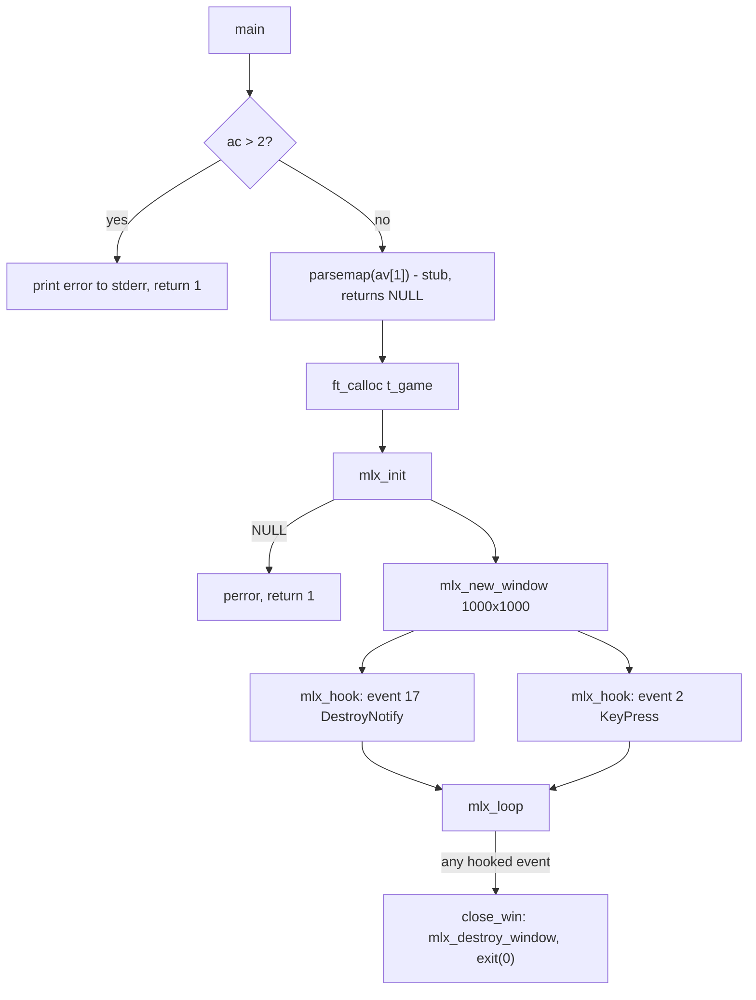
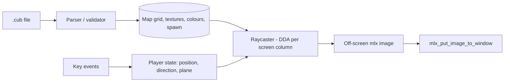

# Architecture

This document describes the engine in two parts: what exists in the code
today (section 1) and the planned raycasting pipeline the project is built
toward (section 2). Everything in section 2 is a design intent, **not**
existing code.

## 1. Current state

The whole program lives in `main.c` and `main.h`.



### Data

`t_game` (in `main.h`) holds only the two MiniLibX handles:

```c
typedef struct s_game { void *mlx; void *win; } t_game;
```

### Input

`mlx_hook` registers `close_win` for X11 event 17 (window close) and event 2
(`KeyPress`, mask `1L<<0`). `close_win` does not inspect the keycode, so
every key quits.

### Parsing

`parsemap(char *file)` returns `NULL` and ignores its argument. Its result
is stored in a local variable and never used. Note that `av[1]` is read even
when no argument was given (`ac == 1`), which is undefined behaviour in the
current code once parsing is implemented to dereference it.

### Rendering

None yet: no image buffer is created, nothing is drawn, and no loop hook
(`mlx_loop_hook`) is installed.

### Dependencies

- **MiniLibX** (`mlx.h`, `libmlx.a`) for window, events and (later) images.
- **libft** (`libft/`) provides `ft_calloc` and `ft_putendl_fd`, which are
  the only helpers the code uses today. It is built by the top-level
  Makefile and moved to `./libft.a`.
- `math.h` and `sys/time.h` are already included in `main.h`, in
  anticipation of raycasting and frame timing.

## 2. Planned design (not implemented)

A conventional cub3D pipeline, as the existing includes suggest:



1. **Parsing** - read the file into a grid plus texture paths and floor and
   ceiling colours; validate that the map is closed and has one spawn.
2. **Raycasting** - for each screen column cast a ray from the player using
   the DDA algorithm, find the first wall hit and its distance.
3. **Rendering** - draw a vertical wall slice scaled by `1 / distance` into
   an off-screen image (`mlx_new_image`, `mlx_get_data_addr`), then present
   it with `mlx_put_image_to_window` from a `mlx_loop_hook`.
4. **Input** - key press/release events updating movement and rotation
   state on `t_game`, replacing the current "any key quits" behaviour.

The MiniLibX API needed for all of this is already declared in `mlx.h`.
